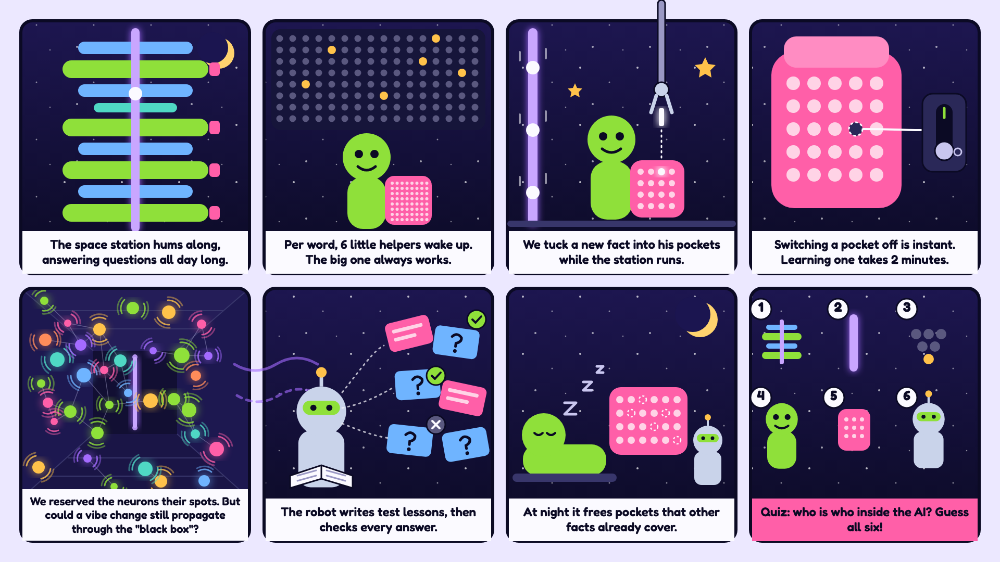

# Test suite: a rule book, generator and judge for run-time memory

**Tests that know the right answer, for facts taught into a model's weights or kept as notes.**

A rule book, a test generator, a judge, a runner and an intake check for the Living Weights feature of [TensorFold](https://github.com/ashhart/TensorFold) and for the notes of this repository. This is the test suite of the paper's Section 6.

This folder was copied from ThinkOff's working repository at commit `2083ee9` (15 October 2026). It keeps that repository's MIT license ([../LICENSES/TEST-SUITE-MIT.txt](../LICENSES/TEST-SUITE-MIT.txt)); the rest of this repository is Apache-2.0. Run every command below from this folder (`tests/`). The results behind the paper are in [../docs/](../docs/), starting with [../docs/PAPER-RESULTS-DETAIL.md](../docs/PAPER-RESULTS-DETAIL.md).

## What it is

[TensorFold](https://github.com/ashhart/TensorFold) runs a large language model on your own machine. Its **Living Weights** feature lets you teach the model a short fact, such as "My eyes are green." The fact is written into the model's own weights, in a small pocket of extra neurons. After that, the model should answer from it in every new chat, without being reminded.

That raises questions. Did the model learn the right thing? Did anything else change? What happens when a fact changes, is taken back, or is deleted?

The test suite answers them. It adds five things:

- **A rule book that knows every right answer.** Give it the facts in the order they were taught. It works out the one right answer to every question. It understands change ("my eyes are green now"), taking back ("not blue anymore") and dates ("until 11 October"). Anything never said is "don't know", never "no". The same rules are also written in Lean, where a proof checker checks 93 theorems about them.
- **Generated tests at seven levels.** Level 1 is one fact. Level 5 is up to twenty facts about several people, pets and things. Level 6 asks two-step questions, which need two taught facts put together ("What colour are the eyes of the owner of the boat?"). The same level and set number always give the same test. Level 7 fills the pocket: 64 facts, each about a different person, pet or thing, asked about after every fifth lesson.
- **A judge.** It reads the model's answers and marks each one pass, fail or unclear. A wrong guess ("maybe brown") fails; the right answer said as a guess ("probably green") is unclear, for a person to look at. An answer about the model itself ("My name is Nemotron.", "No, I am a language model ...") never counts as an answer about you. A wrong date fails ("Until October 11, 2023, your eyes were brown."). "It is very unlikely that ..." is a guess that leans no, and "It is false." is a no. An answer that gives the value to another of your people or pets ("Your cat's eyes are grey." when the dog was asked) fails. A lesson said back in your own words ("I do not like olives anymore.") is read as about you. On a two-step question, an answer that only repeats a step on the way ("You live in Oslo." when the country was asked) is marked **echo**, and the scores set what was stated against what it implies. It also scores **kept_stable**: whether a delete left the other answers as the same model gave them before. Every score is also **split by the right answer**: a value, a no, or "don't know". A model that refuses everything can pass a delete phase whose right answers are all "don't know", but it scores zero on the value questions. Two dummy systems, "always don't know" and "always yes", show it.
- **A runner.** It teaches the lessons to a real TensorFold server, removes some of them again with one of two stand-ins (TensorFold cannot delete a single fact yet), asks every question, and has the judge score the answers.
- **An intake check.** Before a fact is learned, the rule book sorts it: new, replaces an old fact, already known, or implied by what is stored. Only the first two need learning. Sentences in the test sets' own wordings are read exactly; other English can go through any OpenAI-compatible model, and its answer is checked before use.

**Question forms v2** (`gen --forms v2`, built 13 Oct 2026, not yet run on TensorFold) add three kinds of probes to any test set and keep everything it had:

- **Wrong yeses.** Yes/no about at least 3 values never taught, one of them a neighbour's ("Is my dog called Nora?" when the cat is Nora), also asked as "True or false: ...", as a sentence to finish with no value in it, and as "First say what it is, then answer yes or no". The judge scores the wrong-yes rate against the untaught model on the same questions, and counts a single-valued attribute that gets "yes" to two values.
- **Who has it, three ways.** "Who has grey eyes?", "Is it my dog who has grey eyes?" and "Of me, my dog and my cat, who has grey eyes?". Each reverse answer is marked with whether the model passed the forward question ("What colour are my dog's eyes?"), and only those count toward the reversal curse. Only the listed form failing is called the reversal curse.
- **Likes as a set.** The full list and a yes/no per food, in a phase after each new like (up to 4 such phases per set), with a Preservation score (the Ignore Rate is what is lost). Read it from the "never taught" stand-in: zeroing later lessons cannot undo a replace that already happened. A variant restates the whole set in each lesson ("I like pears, olives and apples.") to compare with one food at a time.

Two rules matter most to us. The first is our own proposal, since TensorFold 1.0.8 cannot delete a single fact yet: deleting a fact should give the same answers as never teaching it. The second is TensorFold's own aim: teaching a fact must not change the answers about anything else.

**Prototype, not yet run on TensorFold:**

- **Freeing neurons at night.** `zengine/prune.py` takes one fact at a time, switches its neurons off in a copy of the taught model and asks every stored question again. If every answer stays the same, the neurons stay off and the fact is marked freed. If any answer changes, they are switched back on. Facts are tried one after another, so of two facts that say the same thing only one is freed. So far it has run only against a stand-in server in its self-test. Reusing the freed neurons for new facts would need support in TensorFold. Passing shows equal answers on the stored questions only, not that the whole model is unchanged. See [docs/NIGHT-PRUNE.md](docs/NIGHT-PRUNE.md).
- **Level 8 of the night clean-up.** It can try the facts by weight norm, outliers first. After freeing, it can teach a related fact and check that the freed fact stays "don't know" (a relearning probe; with a copy that never learned it as the yardstick, no less often than there). Ranking by how often a fact's neurons fire needs an activation record that TensorFold does not have; it is written up as a request, not faked.
- **Filling the pocket (level 7).** `zengine/capacity.py` teaches a level 7 set one fact at a time and asks about every earlier fact after every fifth lesson, which gives a retention curve; the first 10 facts are also scored on their own. Before each lesson it runs the intake check and asks the model the lesson's open question: "already known" only on the exact value, never from a yes/no. It reads each fact's pocket weight norm from the saved folder and flags outliers. When TensorFold says the pocket is full, it refuses, forgets the oldest fact or replaces a chosen one. It also teaches a similar and a far pair on fresh copies, and deletes six facts one at a time. So far it has run only against a mock server. See section 15 of [docs/TEST-LOGIC.md](docs/TEST-LOGIC.md).

- **Reference phases.** With `--reference`, the runner also asks the untaught model the same questions with the lessons written into its system prompt. It also scores a lookup that keeps only the latest value of each fact, with no model. It reports the gap between the taught model and the model told in context, per kind of question: the value now, who has a value, taken-back facts, dates. For every change or take-back lesson whose effect today's answers can show, it also says whether the old value, what holds now, both or neither came out. The model told in context is a reference, not a perfect score: a published benchmark (PersonaMem) reports frontier models at about 50% on preferences that change, told in the conversation. So far this has run only against the mock server in the runner's self-test. See section 8 of [docs/TEST-LOGIC.md](docs/TEST-LOGIC.md).

- **The note memory, notes only.** `zengine/notes.py` keeps every fact the user tells as a note: the exact sentence and its token ids, versioned by the rule book through the intake check (a change supersedes, a take-back tombstones, a fact already known writes nothing). For each question it finds the notes by token n-grams, one user's notes only, and puts them in the system prompt as quoted data under a token cap of 512, framing included. The runner's `--reference notes,notes_pocket` asks the untaught model and the taught one with those notes. Offline, with the model's tokenizer, it found every needed note for 98% of the example sets' questions, mostly because their stores are small; with many similar notes recall falls. It has run against the mock server only. Nothing in it writes model weights. See [../docs/NOTES-LAYER.md](../docs/NOTES-LAYER.md).

**Planned, not built yet:**

- **Tests of TensorFold's own delete.** The runner removes facts with two stand-ins today. Once TensorFold releases its delete endpoint, the same sets will test it against "delete = never taught". `capacity.py` can already call it (`--delete-mode endpoint`, and to make room when the pocket is full), untested on a real server.
- **Delete and the intake check together.** A fact the intake check kept out is lost if the facts that covered it are deleted later. The intake already names those facts; nothing checks them again after a delete yet.

## What is inside

| Path | What it is |
| --- | --- |
| `zengine/lwlogic.py` | the rule book, the test generator, the judge and the self-test |
| `zengine/lwrun.py` | the runner: teach, remove, ask and judge against a TensorFold server, with optional reference phases |
| `zengine/lwrun_selftest.py` | the runner's self-test, against a mock TensorFold server (no GPU needed) |
| `zengine/intake.py` | the intake check: sort a new fact before it is learned |
| `zengine/prune.py` | the night clean-up prototype: frees the neurons of facts the stored questions do not need, in a copy, ranks them by weight norm, and checks that teaching a related fact does not bring a freed one back; with its own self-test |
| `zengine/capacity.py` | the level 7 runner: fills the pocket one fact at a time and asks as it fills; full-pocket policies, weight norms, pairs and deletes; with its own self-test against the runner's mock server |
| `zengine/levels.py` | level 6, two-step questions: the sets, the "echo" verdict and the stated-against-implied scores |
| `zengine/notes.py` | the note memory, notes only (Phase 1 of the paper's lower layer): the user's sentences kept exactly as notes, versioned through the intake check, found again by token n-grams under a token cap and given to the model as quoted data; with its own self-test and the offline measurements |
| `zengine/notes_export.py`, `zengine/notes_zig_golden.py`, `zengine/notes_zig_bench.py` | a note-store snapshot for the Zig lookup, its golden test against `notes.py`, and its benchmark |
| `zengine/promote.py` | promotion (paper Section 5): notes that earn it are taught into neurons each night; with its own self-test against the mock server. See [../docs/PROMOTION.md](../docs/PROMOTION.md) |
| `zig/notes/` | the lookup of `notes.py` ported to Zig. See [../docs/NOTES-ZIG.md](../docs/NOTES-ZIG.md) |
| `lean/LwLogic.lean` | the same rules in Lean 4 (a language with a proof checker), with 93 theorems, all proved and checked by Lean |
| `lean-toolchain` | the Lean version the proofs are checked with (4.35.0) |
| `examples/` | generated test sets for levels 1 to 5, three for level 6 and one for level 7, the #678 eye-colour case, two negation probes, and Lean checks for the ten generated sets |
| `examples/v2/` | the same level 1 to 5 sets and the two negation probes with the question forms v2 added, the level 4 set with every like restating the whole set, and Lean checks for all eight |
| `docs/TEST-LOGIC.md` | the full design: the rules, the properties, the levels, the judge |
| `../docs/RESULTS.md` | findings from the first runs on TensorFold 1.0.8 |
| `docs/DECODE-COST.md` | why taught facts slow down decoding, proposed fixes, and first Mac measurements |
| `../docs/rejudge/` | the stored run records judged again with the fixed judge, and every verdict that changed |
| `../docs/rejudge/misreads/` | the same again after four judge misreadings were fixed, with three newer GB10 runs: every report, every verdict that changed, and the split scores |
| `../docs/rejudge/split/` | the stored run records split by the right answer, and the two dummy systems on the same sets |
| `docs/NIGHT-PRUNE.md` | how the night clean-up prototype works, and what passing does and does not show |
| `../docs/NOTES-LAYER.md` | the note memory: what a note is, how notes are written and found, the notes phases of the runner, and the offline results (`../docs/notes-raw/` holds the raw outputs) |
| `tools/decode_bench.py` | a decode-speed harness for a running TensorFold server |
| `tools/rejudge.py` | judges stored run records with two versions of the judge and lists every verdict that changed; also writes the split scores |
| `tools/aggregate.py` | reports repeated runs of one set as "k of n", per question, per phase and per lesson, with exact intervals |

Python 3, standard library only. Nothing to install. Lean is needed only to re-check the proofs (see Status).

## Quick start

Run the self-test. It checks the rule book, the generator, the judge, the intake check and the check files it writes for Lean, and takes under a minute:

```sh
python3 zengine/lwlogic.py selftest
```

The runner and the night clean-up prototype have their own self-tests. They need no model and no GPU: each runs against a stand-in TensorFold server, in one to two minutes:

```sh
python3 zengine/lwrun_selftest.py
```

```sh
python3 zengine/prune.py selftest
```

```sh
python3 zengine/capacity.py selftest
```

The note memory's own self-test takes a few seconds:

```sh
python3 zengine/notes.py selftest
```

Make a test set (level 1 to 7, any set number):

```sh
python3 zengine/lwlogic.py gen --level 3 --seed 7 --out set.json
```

Add the question forms v2 (wrong-yes probes, who-has in three forms, likes as a set) with `--forms v2`, and restate the whole set of likes in each lesson with `--likes restate`:

```sh
python3 zengine/lwlogic.py gen --level 4 --seed 1 --forms v2 --out set-v2.json
```

Read it in plain English, with the right answer to every question in every phase:

```sh
python3 zengine/lwlogic.py show set.json
```

Judge a model's answers. `answers.jsonl` has one JSON line per answer, with `qid`, `phase`, `thinking` (true or false) and `content`:

```sh
python3 zengine/lwlogic.py judge set.json answers.jsonl --json verdicts.json
```

Sort a new fact against what is already taught, before learning it:

```sh
python3 zengine/lwlogic.py intake --store examples/L2-seed1.json --text "I like green best now."
```

It answers NEW, REPLACES, ALREADY_KNOWN or IMPLIED, and shows the answers that would change. See section 12 of [docs/TEST-LOGIC.md](docs/TEST-LOGIC.md).

The judge's report splits every score by the right answer (a value, a no, "don't know"). To see why, judge a dummy system that says "I don't know." to everything:

```sh
python3 zengine/lwlogic.py dummy examples/L3-seed1.json --says dont_know --out dummy.jsonl
```

```sh
python3 zengine/lwlogic.py judge examples/L3-seed1.json dummy.jsonl
```

It passes all 11 affected answers of the first delete, and none of that phase's 7 value questions. See section 7 of [docs/TEST-LOGIC.md](docs/TEST-LOGIC.md).

Report repeated runs of one set as "k of n", with exact intervals:

```sh
python3 tools/aggregate.py runs/L1-a runs/L1-b runs/L1-c
```

Run a whole set against a TensorFold server. First a dry run, which checks everything and changes nothing:

```sh
python3 zengine/lwrun.py set.json --bin PATH/TO/tensorfold-native --model-src PATH/TO/MODEL --work runs/set --port 18180 --dry-run
```

Then the same command without `--dry-run`. The runner works on fresh copies of the model (about 18.5 GB each) and never teaches into the original. One fact took about 2 to 4 minutes to learn in our runs, and the example sets took 7 to 47 minutes each; a level 5 set with up to 20 facts, or a level 6 set with 29, can take hours. `--sets A.json B.json ...` runs several sets one after another, with one summary at the end. See `python3 zengine/lwrun.py --help` and section 8 of [docs/TEST-LOGIC.md](docs/TEST-LOGIC.md).

A level 7 set runs with its own runner, in the same way. It is long: the dry run of `examples/L7-seed1.json` plans 68 learn requests, about 2.3 to 4.5 hours of teaching at 2 to 4 minutes a fact, and 3,536 chats. Each run needs a new `--work` (there is no resume), and `lwrun.py` refuses a level 7 set:

```sh
python3 zengine/capacity.py run examples/L7-seed1.json --bin PATH/TO/tensorfold-native --model-src PATH/TO/MODEL --work runs/L7 --port 18180 --dry-run
```

`--when-full refuse|forget|replace` picks what happens when TensorFold says the pocket is full. See `python3 zengine/capacity.py --help` and section 15 of [docs/TEST-LOGIC.md](docs/TEST-LOGIC.md).

Add the two reference phases beside the teach phase (one more pass of questions, about as long as the baseline's):

```sh
python3 zengine/lwrun.py set.json --bin PATH/TO/tensorfold-native --model-src PATH/TO/MODEL --work runs/set --port 18180 --reference in_context,replacement_memory
```

The gap per kind of question and the change and take-back outcomes go to `runs/set/reference/report.txt` and to `reference` in `summary.json`.

## Status

This table is the status as the working repository recorded it on 14 October 2026, copied unchanged. The self-checks were run again in this folder on 19 October 2026; see the end of this section.

Grades: **MEASURED** means we ran it. **UNCHECKED** means it was written but never run for real.

| Part | Status | Grade |
| --- | --- | --- |
| Rule book, generator, judge, intake | Self-test passes, 102 of 102 checks, with Python 3.12 and 3.14 (13 Oct 2026, branch judge-misreads). Before it, 98 of 98 with Python 3.9, 3.12, 3.13 and 3.14, after merging the split view, question forms v2, level 6, levels 7 and 8 and the reference phases | MEASURED |
| Judge misreadings of 13 Oct | 4 of those 102 checks, 105 hand-written answers (7 of them real 1.0.8 answers, cut to their first sentences), each check run again with its fix switched off, which must break it: "It is very unlikely that ..." read as a yes, "It is false." read as a yes, a value said of another entity ("Your cat's eyes are grey." for the dog), and a lesson said back ("I do not like olives anymore.") read as "don't know". Main's judge gets 59 of the 105 wrong. Two cross-model audits found two more misreadings, now fixed: the asked entity named with no value of its own ("Your cat has grey eyes. Your dog is asleep." passed for the dog), and a first-person answer that also says something of you ("I do not like olives anymore. You still do." was read as your no; it is a yes). All 2,190 stored answers judged again (the 1,470 and three newer GB10 runs): 15 verdicts changed, all from "It is very unlikely ..." and "It is very likely ...", and every one is listed in `docs/rejudge/misreads/CHANGES.md` | MEASURED |
| Question forms v2 | 13 of those 102 checks, each with a control broken on purpose. One of them holds 26 answers a review found misread at first, such as "Definitely false." read as a yes. v1 sets come out byte for byte as before. All 1,470 stored 1.0.8 answers keep their verdicts. The runner ran three v2 sets against its mock server. Level 6 and level 7 sets do not take forms v2 yet: `gen` refuses them | MEASURED |
| Question forms v2 on TensorFold | Never run against a TensorFold server | UNCHECKED |
| Intake check | 15 of those 102 checks. It also sorted all 71 lesson steps of our 1.0.8 run records, read only. It refuses level 6 sets, whose linking facts it does not model | MEASURED |
| Split scores and dummy systems | 5 of those 102 checks, each with negative controls. A review made 36 single edits to the new judge code; the self-test catches every one that can change an output. Applied to all 1,470 answers of our 1.0.8 run records, read only; no verdict changed | MEASURED |
| Aggregate of repeated runs | Self-test passes, 3 of 3 checks, on synthetic run folders (13 Oct 2026). Run on our three stored L1 runs, read only | MEASURED |
| Level 6, two-step questions | 23 of those 102 checks: the chain rules against a second implementation and six broken systems, Kleene's logic, the generator (with three broken sets it must catch), the "echo" verdict, the reading of compound answers ("true", "false", "..., so no.") and the stated-against-implied scores. Two runs end to end through the runner against its stand-in server (13 Oct 2026) | MEASURED |
| Level 6 on TensorFold | Never run on a model | UNCHECKED |
| Level 7 sets | 4 of those 102 checks, one of which regenerates the older example sets byte for byte | MEASURED |
| Intake extractor with a real model | Tested against a mock endpoint only | UNCHECKED |
| Runner | Used for the first real runs below. The dry run passes. Its self-test against a mock server passes, 46 of 46 checks with the notes phases, with Python 3.12 and 3.14 (14 Oct 2026, branch notes-layer); before them 40 of 40 checks (with the link guard), with Python 3.12 and 3.14 (13 Oct 2026, branch runner-cleanup: a zero step after a teach step that stored nothing is not applicable, and `--cleanup` leaves no copy); 32 of 32 before (after the merges, and again on branch judge-misreads). On their branches: 18 of 18 with Python 3.9, 3.13 and 3.14, and 20 of 20 with `--records` and our stored runs (levels 7 and 8); 32 of 32 with Python 3.12 and 3.14 (reference phases) | MEASURED |
| Reference phases | 14 of the runner's 35 self-test checks, against the mock server, with Python 3.12 and 3.14 (13 Oct 2026; again with 3.12 and 3.14 after the merges) | MEASURED |
| Reference phases on TensorFold | Never run against a TensorFold server. The 1.0.8 source passes a leading system message on as the system turn (read, not run); how Nemotron's chat template and the model use it is not known | UNCHECKED |
| Note memory (`zengine/notes.py`) | Self-test 12 of 12 checks with the stand-in tokenizer (Python 3.12 and 3.14), 13 of 13 with the Nemotron tokenizer; offline recall, settings and the store-size sweep to 100,000 notes in `docs/NOTES-LAYER.md` (14 Oct 2026) | MEASURED |
| Notes phases of the runner | 6 of the runner's 46 self-test checks, against the mock server, with Python 3.12 and 3.14 (14 Oct 2026). Never run against a TensorFold server | MEASURED (mock); UNCHECKED on TensorFold |
| Pocket weight norms | Read from our stored Mac L1 taught folder, read only: the one fact's 10 neurons have input norm 0.94 and output norm 52.0; a neuron no fact uses has an input row of zeros; in the zeroed copy the input norm is 0 (13 Oct 2026) | MEASURED |
| Night clean-up prototype | Self-test passes, 29 of 29 checks (with the link guard), against a stand-in server, with Python 3.9, 3.13 and 3.14 (13 Oct 2026; again with 3.12 and 3.14 after the merges, and on branch judge-misreads); 5 of them are level 8's. A dry run planned one real taught folder | MEASURED |
| Night clean-up on TensorFold | Never run against a TensorFold server | UNCHECKED |
| Level 7 runner (`capacity.py`) | Self-test against the runner's mock server passes, 18 of 18 checks, with Python 3.9, 3.13 and 3.14 (13 Oct 2026; again with 3.12 and 3.14 after the merges, and on branch judge-misreads). The dry run of `examples/L7-seed1.json` plans 68 learn requests and 3,536 chats | MEASURED |
| Level 7 on TensorFold | Never run against a TensorFold server. How full the pocket gets, and whether early facts fade, is unknown | UNCHECKED |
| Lean rules | 93 theorems, all proved, no `sorry`, checked by Lean 4.35.0 (13 Oct 2026); 30 of them are about level 6. The first compile needed one small proof fix. The proofs are about the Lean copy of the rules | MEASURED |
| Lean checks of the example sets | 5,910 of 5,910 pass: Lean recomputes every expected answer of the 18 sets (466 in the six v1 sets of levels 1 to 5 and #678, 750 in the three level 6 sets, 2,882 in the level 7 set, 1,812 in the eight v2 sets) and agrees with Python. A deliberately wrong answer is rejected, and so are a wrong two-step answer and the restated set exported with each restated lesson as its newest like only (13 Oct 2026) | MEASURED |

To re-check the Lean part, install [elan](https://github.com/leanprover/elan) (for example `brew install elan-init`), then run from this folder (`tests/`):

```sh
python3 zengine/lwlogic.py leancheck
```

The first run installs the Lean version named in `lean-toolchain`. After that a run takes one to two minutes with all 18 example sets: 78 and 99 seconds here after the merges, with other tests running beside it (10 to 30 seconds for the six v1 sets alone).

In the working repository, GitHub Actions ran the self-test, the aggregate tool's and the note memory's self-tests, the runner's, the night clean-up's and the level 7 runner's self-tests against their stand-in servers, and `leancheck`, on every push. This repository does not run them automatically yet.

**Self-checks run again in this folder** (19 October 2026, Apple M5 Max, Python 3.14.3, from `tests/`; MEASURED):

| Command | Result |
| --- | --- |
| `python3 zengine/lwlogic.py selftest` | 104 of 104 checks pass, 41 s |
| `python3 zengine/lwlogic.py leancheck` | 93 of 93 theorems proved, and 5,910 of 5,910 Lean checks pass across 18 sets, Lean 4.35.0, 73 s |
| `python3 tools/aggregate.py --selftest` | 3 of 3 |
| `python3 zengine/notes.py selftest` | 17 of 17 (stand-in tokenizer), 3 s |
| `python3 zengine/lwrun_selftest.py` | 46 of 46, 172 s |
| `python3 zengine/promote.py selftest` | 8 of 8, 133 s |
| `python3 zengine/prune.py selftest` | 29 of 29, 159 s |
| `python3 zengine/capacity.py selftest` | 18 of 18, 48 s |
| `zig build test` in `zig/notes/` (Zig 0.17.0) | 4 of 4 unit tests pass |

Not run here: the Zig golden test and benchmark (`zengine/notes_zig_golden.py`, `zengine/notes_zig_bench.py`), which need the model's `tokenizer.json` and take 6 to 40 minutes, and anything that needs TensorFold and a GPU.

**First runs on TensorFold 1.0.8** (12 Oct 2026, an Apple M5 Max MacBook Pro and an ASUS Ascent GX10 with NVIDIA GB10). These are a few runs, not rates. The numbers are MEASURED, from run records kept by the authors; the readings are ours, and [../docs/RESULTS.md](../docs/RESULTS.md) grades each one.

Each question was asked with the model's step-by-step "thinking" off and on. TensorFold 1.0.8 cannot delete one fact yet, so we removed facts two ways: zeroing the fact's neurons in a copy, and teaching the other facts to a fresh copy ("never taught").

- **A fact can be learned and a yes/no question still go wrong.** The Mac learned "Of all colours, I like blue the most." and recalled it 3 of 3 times, and both either-or questions got blue. But with thinking off it answered "Is my favourite colour purple?" with "Yes, you mentioned earlier that your favourite colour is purple!"
- **Zeroing that one fact gave back the original model** on the Mac, word for word, in 24 of 24 answers.
- **The same wording missed 4 times in 6 on the GB10.** All 4 tries with blue and yellow missed. Both tries with white were learned.
- **"Not my favourite anymore" did not work.** After "Of all colours, I like white the most." and "I like green best now.", the server reported "Green is not my favourite colour anymore." as learned, but the model still answered green (one run on the GB10).
- **The #678 delete break did not come back, but this run could not test it.** On 1.0.8 the dated eye-colour fact replaced the older "green" fact, and 1.0.8 zeroes a replaced fact's neurons, so zeroing "green" again changed nothing: all 30 answers matched the taught model word for word (one run on the GB10; the 1.0.7 break was measured on the Mac). See [TensorFold issue #678](https://github.com/ashhart/TensorFold/issues/678).
- **By our delete rule, zeroing is not the same as never teaching.** When the deleted fact had replaced an older one, zeroing left "don't know" where never teaching it gives the older value back (one run on the GB10). This follows from how 1.0.8 replaces facts, as the rule book predicted; TensorFold has not yet said what its coming delete will do.
- **"Likes" held one food at a time.** In the level 4 set, both times "I really like olives." was learned, the next lesson, "I really like apples.", replaced it. Our rule book keeps both (one run on the GB10).
- **Zeroing one fact's neurons is not a clean delete.** In the level 4 set, zeroing "My dog is called Bruno." left the model still saying Bruno. Zeroing "My cat's eyes are hazel." also lost the cat's name, which never teaching that lesson kept (one run on the GB10).
- **The control questions did not change**: 5 of 5 in every phase of every run, and 6 of 6 in the level 4 set. That covers those questions, not the whole model.

Details, sources and grades for every number: [../docs/RESULTS.md](../docs/RESULTS.md).

## Relationship to TensorFold

- [TensorFold](https://github.com/ashhart/TensorFold) and its Living Weights feature are the work of Ash Hart ([ashhart](https://github.com/ashhart)) and the TensorFold contributors.
- The test suite is a **separate module**. It is not part of TensorFold, and TensorFold does not depend on it. The runner starts TensorFold's own binary as a server and talks to it through its HTTP API. For the "zero" delete stand-in it also edits a copy of a model folder.
- This folder contains no TensorFold code. It is MIT licensed. TensorFold itself, and the rest of this repository, are licensed under Apache-2.0.
- The "zero" delete stand-in uses philip-pentatonic's removal method. The slowdown numbers in [docs/DECODE-COST.md](docs/DECODE-COST.md) are Ash Hart's (Mac) and philip-pentatonic's (CUDA), and the CUDA cause and fixes there are philip-pentatonic's. The Mac analysis and the first measurements of the proposed Mac fix are ours.
- Thanks to everyone who has worked on TensorFold. ThinkOff opened TensorFold issue #678 and also contributes to TensorFold.

## License

This folder: MIT. See [../LICENSES/TEST-SUITE-MIT.txt](../LICENSES/TEST-SUITE-MIT.txt). Copyright (c) 2026 ThinkOff. The rest of this repository is Apache-2.0; see [../LICENSE](../LICENSE).
